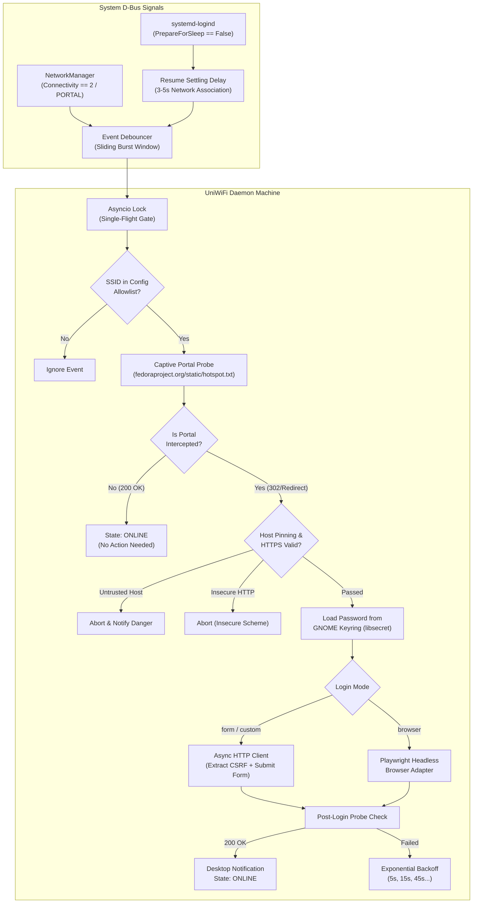

# UniWiFi AutoLogin for Fedora 🎓📶

[](https://getfedora.org/)
[](https://www.python.org/)
[](https://systemd.io/)
[](https://gitlab.gnome.org/GNOME/libsecret)
[](LICENSE)

A robust, secure, zero-touch background daemon engineered specifically for **Fedora Linux** that automates university captive portal authentication. Never see a login splash screen again when waking your laptop in lecture halls, libraries, or dorms.

---

## ✨ Key Features

- **⚡ Zero-Touch Re-Login:** Automatically detects captive portals and re-authenticates in **under 3 seconds** following laptop sleep/resume (`systemd-logind`) or network re-association (`NetworkManager`).
- **🔐 Hardened Credential Storage:** Zero plaintext passwords on disk. Credentials are encrypted in the system keyring via `libsecret` / GNOME Keyring.
- **🛡️ Anti-Phishing & Rogue AP Defense:** Enforces strict HTTPS form submission and host pinning (`allowed_hosts`) to block credential harvesting over rogue access points (Evil Twin attacks).
- **🛑 Account Lockout Protection:** Instantly halts retry loops on HTTP 401 or account lock signatures, preventing university account suspension due to rapid retry storms.
- **🌐 Dual-Engine Architecture:**
  - **Fast Native HTTP Engine:** Submits authentication payloads in milliseconds with automatic CSRF token parsing and form field autodetection.
  - **Headless Browser Fallback:** Seamlessly integrates with headless Playwright (Chromium/Firefox) for JavaScript-heavy, single-page application (SPA), or dynamic verification portals.
- **⚙️ Integrated Systemd User Service:** Runs entirely in unprivileged user space (`systemctl --user uniwifi.service`) with sandboxing flags (`NoNewPrivileges`, `PrivateTmp`, `ProtectSystem=strict`).
- **🩺 Diagnostic Doctor (`uniwifi doctor`):** Built-in self-test validating D-Bus connectivity, keyring backend, file permissions, notification daemon, and service health with auto-remediation (`--fix`).
- **🔔 Desktop Notifications:** Non-intrusive libnotify desktop alerts with custom urgency levels and silent fallback for headless terminal sessions.

---

## 🏛️ Architecture Overview



---

## 📋 System Requirements & Fedora Prerequisites

UniWiFi AutoLogin is designed and optimized for **Fedora 39, 40, 41, and Rawhide**.

Install required system libraries via DNF:

```bash
sudo dnf install -y \
    python3 \
    python3-pip \
    pipx \
    libnotify \
    gnome-keyring \
    libsecret \
    NetworkManager \
    python3-devel \
    gcc \
    dbus-devel \
    glib2-devel

pipx ensurepath
```

---

## 🚀 Quickstart Walkthrough

### 1. Installation

#### Recommended: Install via `pipx`
```bash
pipx install git+https://github.com/Vishwa-Srinath/UniWiFi-AutoLogin-for-Fedora.git
```

#### Alternative: Development Installation
```bash
git clone https://github.com/Vishwa-Srinath/UniWiFi-AutoLogin-for-Fedora.git
cd "UniWiFi-AutoLogin-for-Fedora"
python3 -m venv .venv
source .venv/bin/activate
pip install -e ".[dev]"
```

---

### 2. Reconnaissance (Profile Your University Portal)

Connect to your campus Wi-Fi and analyze the network connection and captive portal signature:

```bash
uniwifi recon
```

For machine-readable JSON output:
```bash
uniwifi recon --json
```

---

### 3. Save University Credentials in System Keyring

Safely store your university username and password into the encrypted OS keyring:

```bash
uniwifi setup
```

Your password is requested interactively with hidden terminal input and transferred directly to `libsecret` / GNOME Keyring. It is **never** written to configuration files or logs.

To verify stored credentials status:
```bash
uniwifi setup --check
```

---

### 4. Configure Portal Settings

Generate and review your configuration file at `~/.config/uniwifi/config.toml`:

```bash
uniwifi config init
```

Edit `~/.config/uniwifi/config.toml` to match your campus network:

```toml
[general]
# Allowed Wi-Fi network SSIDs
ssids = ["Campus-WiFi", "eduroam-guest", "Uni-Secure"]
check_url = "http://fedoraproject.org/static/hotspot.txt"
check_expect = "OK"
probe_timeout = 6.0
max_attempts = 4
base_delay = 5.0
max_delay = 60.0
notify = true
notify_on_failure = true

[portal]
# Authentication mode: "form", "custom", or "browser"
mode = "form"

# Anti-phishing host pinning: restrict form submission to trusted hosts
allowed_hosts = ["portal.campus.edu", "auth.university.edu"]

# Enforce HTTPS (set true ONLY for legacy plain-HTTP test environments)
allow_insecure_http = false

# Custom mode parameters (if mode = "custom")
# login_url = "https://portal.campus.edu/login.php"
# method = "POST"
# username_field = "username"
# password_field = "password"
```

Verify and secure configuration permissions:
```bash
uniwifi config audit --fix
```

---

### 5. Run Diagnostic Health Check

Verify all subsystem dependencies, D-Bus listeners, and keyring integration:

```bash
uniwifi doctor
```

```text
============================================================
              UniWiFi AutoLogin Doctor Report               
============================================================
Overall Status: HEALTHY (Passed: 6, Warnings: 0, Critical: 0)

[OK] Python Runtime: Python 3.12.2 on Linux (x86_64)
[OK] Keyring Backend: SecretService (priority=5.0, secure=True)
[OK] System D-Bus: Connected to org.freedesktop.NetworkManager and org.freedesktop.login1
[OK] Notifications: notify-send available and functional
[OK] File Permissions: 0600 on config.toml and 0700 on config directory
[OK] Systemd User Unit: uniwifi.service installed and enabled
============================================================
```

---

### 6. Test a One-Shot Login

Perform a synchronous test login directly from your terminal:

```bash
# Check current connection state
uniwifi status

# Attempt immediate login
uniwifi login

# Dry-run inspection without submitting credentials
uniwifi login --dry-run
```

---

### 7. Enable Persistent Systemd Background Service

Install and start the background daemon as a systemd user unit:

```bash
# Install and enable the user service
uniwifi service install --enable --start

# Check service status
uniwifi service status

# Follow real-time service logs
uniwifi service logs -f
```

The daemon will now start automatically at login and manage Wi-Fi logins invisibly in the background.

---

## 📖 CLI Command Reference

| Command | Flags / Arguments | Description |
| :--- | :--- | :--- |
| `uniwifi status` | `--json`, `-v` | Checks internet connectivity and prints captive portal redirect URL if intercepted. |
| `uniwifi setup` | `--check`, `--delete`, `-u USER` | Interactively stores or deletes credentials in GNOME Keyring. |
| `uniwifi login` | `--browser`, `--url URL`, `--dry-run`, `--password-stdin` | Manually executes a login attempt. Supports headless browser mode and custom portal URLs. |
| `uniwifi run` | `--foreground` | Runs the full event-driven orchestrator daemon directly. |
| `uniwifi service` | `install`, `uninstall`, `start`, `stop`, `restart`, `enable`, `disable`, `status`, `logs`, `cat` | Manages the `systemd` user service unit lifecycle. |
| `uniwifi doctor` | `--json`, `--fix` | Diagnostic health check inspecting runtime, D-Bus, keyring, permissions, and service. |
| `uniwifi config` | `show`, `init`, `path`, `audit`, `--fix` | Inspects, initializes, and audits security permissions of `config.toml`. |
| `uniwifi recon` | `--interface IFACE`, `--json`, `--probe` | Scans active Wi-Fi adapters and extracts portal login form structure. |
| `uniwifi events` | `--timeout SEC`, `--json` | Diagnostic monitor streaming real-time NetworkManager and login1 D-Bus signals. |
| `uniwifi notify` | `--kind KIND`, `--title TITLE`, `--body BODY` | Triggers a test desktop notification. |

---

## 🔒 Security & Privacy Model

UniWiFi AutoLogin is built with defense-in-depth principles:

1. **System Keyring Encryption:** Passwords are never stored on filesystem or memory swap. Authentication goes through `libsecret` (backed by GNOME Keyring, KDE KWallet, or FreeDesktop Secret Service).
2. **Zero-Log Sensitive Redaction:** The logging system features a strict redaction filter (`RedactingFilter`) that strips passwords, Authorization headers, Bearer tokens, and session cookies from terminal and journald logs.
3. **HTTPS Enforcement:** Target login endpoints must use `https://`. Plaintext `http://` submission is blocked with `InsecureSchemeError` unless explicitly allowed in configuration.
4. **Anti-Phishing Host Pinning:** The daemon validates portal redirect domains against `allowed_hosts`. If an attacker spins up an open "Evil Twin" Wi-Fi network attempting to harvest student credentials, the daemon terminates and raises `UntrustedHostError`.
5. **Strict POSIX Permissions:** Config files are audited for `0600` permissions (read/write only by owner) and directories for `0700`.
6. **Systemd Sandboxing:** The service unit runs with `NoNewPrivileges=true`, `PrivateTmp=true`, `ProtectSystem=strict`, and `ProtectHome=read-only`.

---

## 🌐 JavaScript-Heavy Portals (Playwright Fallback)

If your university uses a complex single-page application (React, Angular, Vue) or custom JavaScript challenges:

```bash
# Install Playwright browser dependencies
pip install "uniwifi[browser]"
playwright install chromium

# Test login using headless browser
uniwifi login --browser
```

To configure headless browser login permanently, set in `~/.config/uniwifi/config.toml`:
```toml
[portal]
mode = "browser"
allowed_hosts = ["portal.campus.edu"]
```

---

## 🛠️ Development & Testing

Run the automated test suite and lint checks:

```bash
# Run all quality checks (ruff formatting, ruff linter, pytest suite)
./scripts/check.sh

# Run pytest directly with coverage
pytest --cov=uniwifi tests/
```

---

## 📄 License

This project is licensed under the **MIT License**. See [LICENSE](LICENSE) for details.
