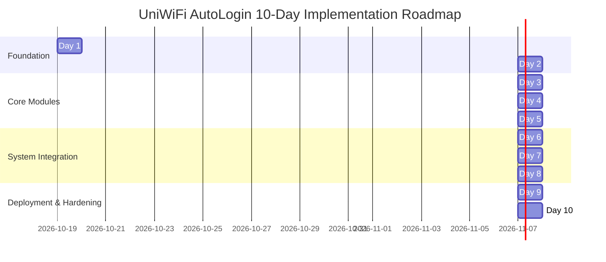

# 10-Day Implementation Plan: UniWiFi AutoLogin for Fedora

This document lays out a structured, 10-day roadmap for implementing, testing, and hardening the **UniWiFi AutoLogin** daemon on Fedora Linux according to the [Architecture & Implementation Guide](file:///home/vishwa_srinath/Desktop/projects/UniWiFi%20AutoLogin%20for%20Fedora/docs/wifi-autologin-fedora-guide.md).

---

## Roadmap Overview



---

## Detailed Daily Breakdown

### Day 1: Project Scaffolding, Tooling & Fedora Environment Setup
* **Objective:** Establish the development environment, Fedora system dependencies, Python package layout, and testing/linting pipelines.
* **Tasks:**
  1. Install Fedora system dependencies:
     ```bash
     sudo dnf install -y python3 python3-pip pipx libnotify gnome-keyring libsecret \
       NetworkManager python3-devel gcc dbus-devel glib2-devel
     pipx ensurepath
     ```
  2. Create Python virtual environment (`.venv`) and configure modern packaging standard:
     - Initialize directory layout: `src/uniwifi/`, `tests/fixtures/`, `packaging/`.
     - Implement [pyproject.toml](file:///home/vishwa_srinath/Desktop/projects/UniWiFi%20AutoLogin%20for%20Fedora/pyproject.toml) declaring dependencies (`dbus-fast`, `httpx`, `beautifulsoup4`, `lxml`, `keyring`, `typer`) and dev dependencies (`pytest`, `pytest-asyncio`, `respx`, `ruff`).
  3. Verify editable installation: `pip install -e ".[dev]"`.
  4. Setup `ruff` linting and formatting configuration in `pyproject.toml`.
* **Deliverables:**
  - Functional virtualenv with all dependencies installed.
  - Valid `pyproject.toml` and baseline package skeleton (`src/uniwifi/__init__.py`).
  - Passing baseline test suite run (`pytest`).

---

### Day 2: Network Reconnaissance & Captive Portal Profiling (Phase 0)
* **Objective:** Determine the authentication mechanism (Type A WPA2/3-Enterprise vs Type B Captive Portal) and capture portal network transactions.
* **Tasks:**
  1. Inspect existing NetworkManager connection settings:
     ```bash
     nmcli connection show
     nmcli -s connection show "YOUR_SSID" | grep -E "key-mgmt|802-1x|flags"
     ```
  2. If network is Type A (`wpa-eap`), verify whether setting `802-1x.password-flags 0` resolves credentials prompt natively.
  3. For Type B captive portals:
     - Connect to university Wi-Fi and open browser DevTools with **Preserve Log** enabled.
     - Perform manual login and isolate the credential submission HTTP request (`POST` or `GET`).
     - Document endpoint URL, HTTP method, username/password field names, and dynamic tokens (CSRF, session cookies, hidden input fields).
     - Save a sanitized copy of the portal login HTML page to `tests/fixtures/portal_login.html`.
     - Replicate the login command via `curl` to verify headless reproducibility.
* **Deliverables:**
  - `docs/recon_notes.md` detailing endpoint specifics, field names, and expected responses.
  - Sanitized fixture `tests/fixtures/portal_login.html` for offline unit testing.

---

### Day 3: Configuration System & Secure Keyring Integration
* **Objective:** Implement structured TOML configuration parsing and safe credential storage backed by the OS keyring (libsecret/GNOME Keyring).
* **Tasks:**
  1. Implement `config.example.toml` specifying general daemon settings (SSIDs, probe URLs, retry caps) and portal parameters.
  2. Implement `src/uniwifi/config.py`:
     - Strongly typed dataclasses: `General`, `Portal`, and `Config`.
     - TOML parsing using standard library `tomllib` (Python 3.11+).
     - Default paths pointing to `~/.config/uniwifi/config.toml`.
  3. Implement `src/uniwifi/credentials.py`:
     - Keyring service namespace: `uniwifi-autologin`.
     - `save(username, password)` and `load() -> tuple[str, str]`.
     - Strict zero-logging policy for passwords.
  4. Write unit tests in `tests/test_config.py` and `tests/test_credentials.py` (mocking the keyring backend).
* **Deliverables:**
  - `src/uniwifi/config.py` & `config.example.toml`.
  - `src/uniwifi/credentials.py`.
  - Unit tests verifying config validation and credential read/write operations.

---

### Day 4: Captive Portal Detector & Probe Engine
* **Objective:** Build an asynchronous probe module that reliably distinguishes between direct internet connectivity and captive portal interception.
* **Tasks:**
  1. Implement `src/uniwifi/detector.py`:
     - Dataclass `ProbeResult(online: bool, portal_url: str | None, html: str | None)`.
     - Asynchronous function `probe(check_url: str, expect: str, timeout: float = 6.0)`.
     - Dedicated plain HTTP probe (default: `http://fedoraproject.org/static/hotspot.txt` expecting `OK`).
     - Redirect handling to capture final landing URL and page content when intercepted.
  2. Implement offline unit tests in `tests/test_detector.py` using `respx`:
     - Test 200 OK genuine internet response.
     - Test 302/307 redirect to portal URL.
     - Test HTTP timeout and connection failure handling.
* **Deliverables:**
  - `src/uniwifi/detector.py`.
  - `tests/test_detector.py` with 100% test coverage on probe states.

---

### Day 5: Form Login Adapter & HTML Scraping
* **Objective:** Implement robust HTML form detection and credential submission adapters.
* **Tasks:**
  1. Implement `src/uniwifi/login.py`:
     - `_autodetect_form(html: str, base_url: str)`: locates login forms containing password inputs, resolves relative action URLs, and gathers hidden fields.
     - `_hidden_fields(html: str)`: extracts CSRF tokens and static hidden payloads.
     - `login(portal: Portal, portal_url: str | None, html: str | None, username: str, password: str)`: submits credentials via `httpx.AsyncClient` with proper TLS verification.
  2. Add safety check: detect invalid credential error signatures in response and raise explicit exceptions to prevent brute-force account lockouts.
  3. Write unit tests in `tests/test_login.py` utilizing `tests/fixtures/portal_login.html`.
* **Deliverables:**
  - `src/uniwifi/login.py` supporting both auto-detect `mode="form"` and explicit `mode="custom"`.
  - Automated tests simulating portal submission and response handling.

---

### Day 6: Notification System & Journald Logging Engine
* **Objective:** Set up non-intrusive desktop notifications and clean journald-friendly logging.
* **Tasks:**
  1. Implement `src/uniwifi/notify.py`:
     - Wrapper around `notify-send` (`libnotify`).
     - Safe fallback when running headless or when `notify-send` is absent.
  2. Implement `src/uniwifi/log.py`:
     - Stream configuration for `sys.stdout` matching systemd journal requirements (omit redundant timestamps since journald prefixes them).
     - Suppress chatty loggers (e.g. `httpx` set to `WARNING`).
     - Redaction layer ensuring passwords, session cookies, and sensitive query tokens are never logged.
  3. Test notification triggers manually via test scripts.
* **Deliverables:**
  - `src/uniwifi/notify.py` and `src/uniwifi/log.py`.
  - Verified visual notifications on desktop environment (GNOME/KDE).

---

### Day 7: Asynchronous D-Bus Event Listeners
* **Objective:** Listen to system D-Bus events for NetworkManager connectivity updates and systemd-logind sleep/resume signals.
* **Tasks:**
  1. Implement `src/uniwifi/events.py` using `dbus-fast.aio.MessageBus`:
     - Connect to `BusType.SYSTEM`.
     - Subscribe to `org.freedesktop.NetworkManager` `PropertiesChanged` on property `Connectivity`.
     - Trigger event on `Connectivity == 2` (PORTAL).
     - Subscribe to `org.freedesktop.login1.Manager` signal `PrepareForSleep`.
     - Implement `_after_resume(delay)` to give Wi-Fi 3-5 seconds to re-associate, followed by `call_check_connectivity()`.
  2. Add error handling and automatic reconnection if D-Bus connection drops.
* **Deliverables:**
  - `src/uniwifi/events.py`.
  - Standalone verification script proving receipt of sleep/resume and network change events.

---

### Day 8: Daemon Orchestrator & State Machine
* **Objective:** Unify event triggers, credential loading, portal detection, login submission, and retry backoff into an asynchronous orchestrator.
* **Tasks:**
  1. Implement `src/uniwifi/daemon.py`:
     - `Daemon` class with `asyncio.Lock` to guarantee single-flight execution (no concurrent login attempts).
     - Event debouncer to absorb burst signals.
     - SSID validation: inspect active connection SSID via NetworkManager and abort if not in configured `ssids` allowlist.
     - Exponential backoff loop (e.g., 5s, 15s, 45s) up to `max_attempts`.
     - Post-login verification: confirm internet access via `detector.probe()`.
     - Main entry loop `run()` running indefinitely under `asyncio`.
  2. Write integration tests for daemon state machine transitions.
* **Deliverables:**
  - `src/uniwifi/daemon.py`.
  - Robust error recovery, rate limiting, and loop protection.

---

### Day 9: CLI Interface & Systemd User Service Integration
* **Objective:** Expose convenient user commands via Typer and establish persistent systemd background execution.
* **Tasks:**
  1. Implement `src/uniwifi/cli.py` with Typer subcommands:
     - `uniwifi setup`: interactive prompt for username and password saving to keyring.
     - `uniwifi status`: probes current connectivity and prints `ONLINE` or `BEHIND PORTAL: <url>`.
     - `uniwifi login`: triggers one-shot synchronous login attempt.
     - `uniwifi run`: launches the long-running async daemon.
  2. Implement `src/uniwifi/__main__.py` entrypoint.
  3. Create `packaging/uniwifi.service` user unit with sandboxing directives (`NoNewPrivileges=true`, `PrivateTmp=true`, `ProtectSystem=strict`).
  4. Test installing into user units: `~/.config/systemd/user/uniwifi.service`.
* **Deliverables:**
  - Complete CLI suite accessible via `uniwifi` binary.
  - Verified systemd user service with `systemctl --user enable --now uniwifi`.

---

### Day 10: Security Hardening, Edge-Case Testing & Final Documentation
* **Objective:** Validate end-to-end reliability, enforce strict security mitigations, and prepare operational documentation.
* **Tasks:**
  1. Security Hardening:
     - Enforce HTTPS for login endpoints unless explicitly overridden.
     - Host pinning (`allowed_hosts` config) to mitigate rogue access point (Evil Twin) credential harvesting.
     - Secure configuration file permissions: `chmod 600 ~/.config/uniwifi/config.toml`.
  2. End-to-End Validation Checklist:
     - Manual login via `uniwifi login`.
     - Interface toggle simulation: `nmcli radio wifi off && nmcli radio wifi on`.
     - Sleep/wake cycle test: `systemctl suspend` and verify auto-reconnect within 10 seconds.
     - Account safety check: simulate wrong password and confirm immediate abort without retry storms.
  3. Optional Playwright fallback: stub/document headless browser mode for JavaScript-dependent portals.
  4. Complete project `README.md` and installation walkthrough.
* **Deliverables:**
  - Fully tested, hardened codebase.
  - Complete test suite passing with high coverage.
  - Clear README and user documentation.

---

## Deliverables & Milestone Tracking Matrix

| Day | Focus Area | Key Output Files | Verification Method |
|:---:|:---|:---|:---|
| **Day 1** | Scaffolding & Env | `pyproject.toml`, directory tree | `pip install -e ".[dev]"`, `pytest`, `ruff check` |
| **Day 2** | Reconnaissance | `docs/recon_notes.md`, `portal_login.html` | `curl -v` login check, fixture validation |
| **Day 3** | Config & Keyring | `config.py`, `credentials.py`, `config.example.toml` | Keyring read/write test, config load test |
| **Day 4** | Portal Detector | `detector.py`, `tests/test_detector.py` | `pytest tests/test_detector.py` (respx mock) |
| **Day 5** | Form Login Adapter | `login.py`, `tests/test_login.py` | `pytest tests/test_login.py` against fixture |
| **Day 6** | Logging & Notify | `notify.py`, `log.py` | `notify-send` test on desktop, journald format |
| **Day 7** | D-Bus Listeners | `events.py` | Test script listening for live NM/logind events |
| **Day 8** | Daemon Orchestrator| `daemon.py` | Simulated trigger test, backoff timing check |
| **Day 9** | CLI & Systemd Unit | `cli.py`, `packaging/uniwifi.service` | `uniwifi status`, `systemctl --user status uniwifi` |
| **Day 10**| Hardening & E2E | `README.md`, security guards | Full sleep/resume cycle & bad credential test |
