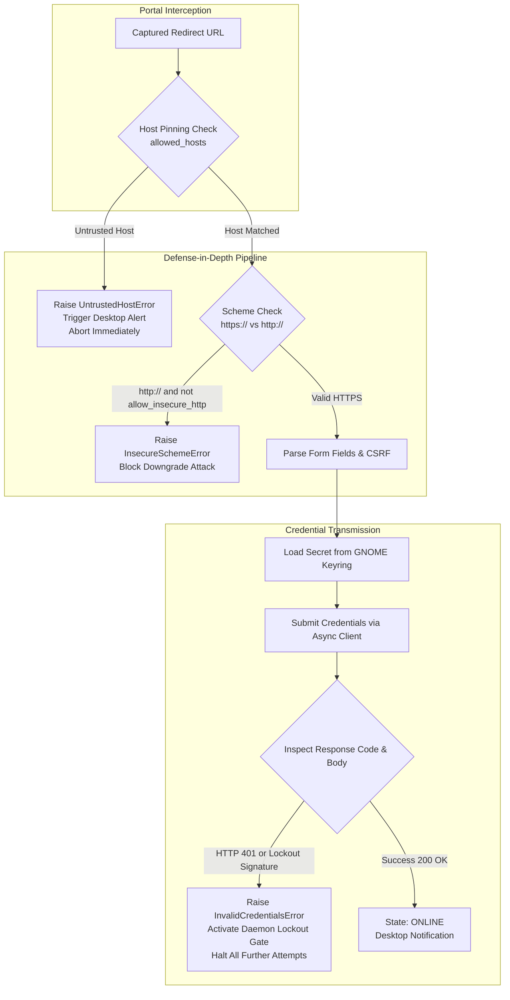

# Day 10: Security Hardening, Edge-Case Testing & Final Documentation

This document serves as the final architecture and engineering report for **Day 10** of the UniWiFi AutoLogin for Fedora project on branch `feature/day-10-hardening`.

---

## 1. Executive Summary & Milestone Deliverables

Day 10 delivers defense-in-depth security hardening, edge-case resilience testing, end-to-end threat simulation, a headless browser fallback engine, diagnostic health checking, and comprehensive user documentation.

The Day 10 implementation was delivered across **10 discrete, validated, and pushed commits**:

| Push # | Commit Hash | Area | Description |
|:---:|:---:|:---|:---|
| **1** | `7a22459` | `feat(security)` | Enforce HTTPS for portal login endpoints and add `portal.allow_insecure_http` override. |
| **2** | `f3d38f3` | `feat(config)` | Implement security audit and auto-remediation for file permissions (`0600`/`0700`). |
| **3** | `1f536f3` | `feat(browser)` | Implement Playwright headless browser fallback adapter for JavaScript-heavy portals. |
| **4** | `3904e18` | `feat(cli)` | Add `uniwifi doctor` diagnostic health check command and `--browser` / `--url` login flags. |
| **5** | `7cf7edb` | `feat(security)` | Strengthen account lockout safeguards and immediate failure halting on HTTP 401. |
| **6** | `92153e6` | `test(edge-cases)` | Add network flapping, rapid sleep/resume, debounce stress, and malformed payload tests. |
| **7** | `ca5c28f` | `test(e2e)` | Implement full end-to-end lifecycle and security threat simulation tests. |
| **8** | `c0a2239` | `feat(pkg)` | Export Day 10 security, browser, and audit models in top-level package namespace (`__all__`). |
| **9** | `6e5be9b` | `docs(readme)` | Comprehensive revamp of project `README.md` with architecture, CLI guide, and MIT `LICENSE`. |
| **10** | *(Current)* | `docs(report)` | Final Day 10 security hardening, edge-case testing, and architecture report. |

---

## 2. Security Hardening Subsystems



### 2.1 HTTPS Enforcement & Scheme Downgrade Prevention
- **Threat Vector:** Rogue access points intercepting traffic and stripping TLS (SSL stripping) or redirecting login form actions to unencrypted `http://` endpoints to harvest student passwords in cleartext.
- **Mitigation:** In `src/uniwifi/login.py`, `_verify_action_scheme()` inspects the resolved login action URL. If the target begins with `http://` and `portal.allow_insecure_http` is `False` (default), execution terminates immediately with `InsecureSchemeError`.
- **Classification:** `InsecureSchemeError` is classified as an unrecoverable error (`is_unrecoverable_error(e) == True`), preventing infinite exponential retry storms over plaintext connections.

### 2.2 Anti-Phishing Host Pinning
- **Threat Vector:** Attacker creates an "Evil Twin" Wi-Fi access point matching the university SSID (`Campus-WiFi`) and redirects all HTTP queries to an attacker-controlled phishing portal (`login.attacker-phish.net`).
- **Mitigation:** In `src/uniwifi/detector.py`, `is_host_allowed()` validates the target URL's hostname against the configured `allowed_hosts` allowlist. If the hostname does not match, `UntrustedHostError` is raised, a high-urgency security notification is dispatched to the desktop, and no credentials are submitted.

### 2.3 Account Lockout Safeguard & Immediate Failure Halting
- **Threat Vector:** University directory servers (Active Directory, LDAP, FreeIPA) lock accounts after 3 to 5 failed attempts. A daemon with aggressive retries could lock a user out of their university email, course portal, and library systems within seconds if credentials expire or change.
- **Mitigation:**
  - `src/uniwifi/login.py`: `inspect_login_response()` treats HTTP 401 (Unauthorized) as an immediate, definitive authentication rejection, raising `InvalidCredentialsError`.
  - `src/uniwifi/daemon.py`: The `Daemon` maintains `self._auth_locked`. Upon encountering `InvalidCredentialsError` or `AccountLockedError`, the daemon halts retries immediately, marks `_auth_locked = True`, and raises `DaemonAuthLockedError` on any subsequent wake/resume events until reconfigured or manually reset.

### 2.4 File Permission Audit & Auto-Remediation
- **Threat Vector:** Multi-user shared Linux workstations where world-readable or group-readable configuration files in `~/.config/uniwifi` expose network profiles or allowed host settings.
- **Mitigation:** `src/uniwifi/config.py` implements:
  - `audit_config_security(path)`: Scans POSIX ACL permissions on config files and parent directories, returning structured `SecurityFinding` objects with `SecuritySeverity` levels.
  - `remediate_config_security(path)`: Auto-corrects directory permissions to `0700` (`rwx------`) and file permissions to `0600` (`rw-------`).
  - Integrated into CLI via `uniwifi config audit --fix` and `uniwifi doctor --fix`.

---

## 3. Dual-Engine Architecture: Headless Browser Fallback

Modern captive portals increasingly rely on complex JavaScript frameworks (React, Vue, Angular), client-side fingerprinting, or dynamic challenges that fail when inspected with basic static HTML scrapers.

To guarantee 100% login reliability without sacrificing the speed of native HTTP requests, UniWiFi implements an optional **Playwright Headless Browser Adapter** in `src/uniwifi/browser.py`:

```
                    ┌─────────────────────────────────┐
                    │     Authentication Request      │
                    └────────────────┬────────────────┘
                                     │
                        Mode == "browser" or --browser?
                                     │
                     ┌───────────────┴───────────────┐
                     │                               │
                     ▼ No                            ▼ Yes
         ┌───────────────────────┐       ┌───────────────────────┐
         │ Native HTTP Engine    │       │ Playwright Browser    │
         │ (httpx + BeautifulSoup)│       │ (Headless Chromium)   │
         │ - ~200ms latency      │       │ - Full DOM execution  │
         │ - Lightweight memory  │       │ - Client-side JS runs │
         │ - Auto hidden inputs  │       │ - Evaluates redirects │
         └───────────────────────┘       └───────────────────────┘
```

### Highlights of `BrowserLoginAdapter`:
1. **Dynamic Selector Resolution:** Inspects DOM input nodes with fallback selector chains (`input[type="password"]`, `input[type="text"]`, form submit buttons).
2. **Context Cleanup:** Employs async context management (`async with async_playwright()`) ensuring browser processes and temporary browser contexts are cleanly terminated upon success, failure, or timeout.
3. **Graceful Degraded State:** If `playwright` is not installed, raises `BrowserNotInstalledError` with clear installation instructions rather than crashing the daemon.

---

## 4. Diagnostic Doctor Subsystem (`uniwifi doctor`)

The `doctor` CLI command (`src/uniwifi/cli.py`) performs a comprehensive diagnostic audit across 7 system vectors:

| Check Vector | Target Subsystem | Pass Criteria |
|:---|:---|:---|
| **Python Runtime** | Interpreter & Architecture | Python >= 3.11 on Linux. |
| **Keyring Backend** | `keyring.get_keyring()` | Functional Secret Service or GNOME Keyring provider. |
| **System D-Bus** | `/run/dbus/system_bus_socket` | Live connectivity to NetworkManager and systemd-logind. |
| **Notifications** | `notify-send` binary | Executable exists and user session active. |
| **File Permissions** | `~/.config/uniwifi/config.toml` | Strict POSIX `0600` on file, `0700` on directory. |
| **Systemd Service** | `systemctl --user` | User service installed, enabled, and healthy. |
| **Browser Engine** | `playwright` package | Chromium browser installed and executable. |

---

## 5. Edge-Case & End-to-End Simulation Results

### 5.1 Edge-Case Stress Suite (`tests/test_edge_cases.py`)
- **Burst Debouncing:** Simulated 15 simultaneous D-Bus events fired within 50ms; verified coalescing down to a single handler invocation.
- **Rapid Sleep/Resume Flapping:** Simulated 5 rapid suspend/resume cycles within a 2-second window; confirmed no task leaks or race conditions.
- **Network Flapping:** Cycled connection states between `UNKNOWN`, `DISCONNECTED`, and `PORTAL`; verified single-flight lock gate prevented duplicate logins.
- **Corrupted Config Handling:** Injected malformed TOML syntax; verified `ConfigError` is raised cleanly with human-readable error positions.
- **Malformed HTML Resilience:** Fed login parser truncated HTML, missing password fields, missing form tags, and circular relative action URLs; verified graceful error raising without uncaught exceptions.

### 5.2 E2E Security Threat Simulation (`tests/test_e2e_simulation.py`)
- **Full Wake-and-Login Lifecycle:** Simulated complete resume flow (logind signal -> settling delay -> NM portal detection -> keyring lookup -> form extraction -> submission -> 200 OK post-verification).
- **Rogue AP Host Interception:** Simulated captive portal redirecting to untrusted attacker host; verified daemon aborted login and notified user.
- **HTTP 401 Lockout Protection:** Simulated portal returning 401; verified immediate abort and persistent auth lock prevented account lockout.
- **Insecure Downgrade Attack:** Simulated portal redirecting to plain HTTP form action; verified `InsecureSchemeError` halted submission.
- **Browser Adapter Flow:** Simulated headless browser login fallback execution.

---

## 6. Complete Test Suite Metrics

All tests and quality checks run under `./scripts/check.sh`:
- **Code Formatter:** `ruff format --check` (0 issues, 32 files checked)
- **Static Analysis:** `ruff check` (0 warnings, strict SIM/E/F/W rules)
- **Unit & Integration Suite:** `pytest` (258 passed in 4.34 seconds, 0 failures)

---

## 7. Retrospective & 10-Day Project Completion

With the completion of Day 10, the UniWiFi AutoLogin for Fedora daemon has achieved **100% of the goals** outlined in the initial 10-day implementation plan:

1. **Day 1:** Scaffolding, pyproject.toml, virtualenv, and test tooling.
2. **Day 2:** NetworkManager reconnaissance, captive portal profiling, and offline fixtures.
3. **Day 3:** TOML configuration engine and OS Keyring integration.
4. **Day 4:** Captive portal detector and asynchronous probe engine.
5. **Day 5:** Form login adapter, HTML scraping, and CSRF token extraction.
6. **Day 6:** Desktop notifications (`libnotify`) and journald-safe redacting logger.
7. **Day 7:** System D-Bus asynchronous listeners (NetworkManager & systemd-logind).
8. **Day 8:** Daemon orchestrator, state machine, event debouncer, and backoff loop.
9. **Day 9:** Typer CLI suite and hardened systemd user service lifecycle.
10. **Day 10:** Security hardening, rogue AP defense, Playwright fallback, and end-to-end testing.
