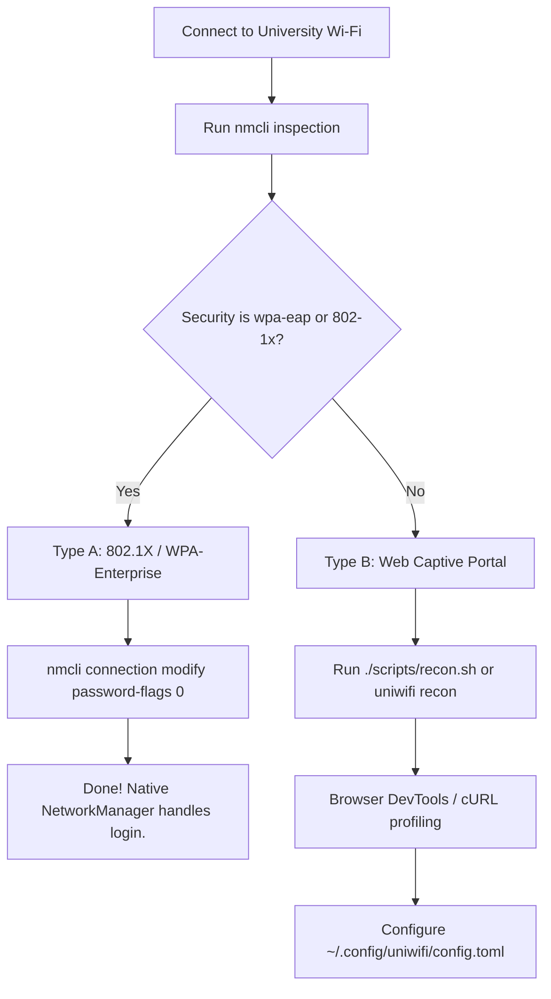

# Phase 0 Reconnaissance & Captive Portal Profiling Guide

Before developing portal automation scripts, you must accurately profile your university Wi-Fi network. This guide details how to classify your network and extract captive portal parameters.

---

## 1. Network Mechanism Diagnosis: Type A vs Type B

University networks enforce authentication through one of two completely distinct methods:



### Type A: 802.1X / WPA-Enterprise (`eduroam`, `Uni-Secure`)
- **Characteristics:** Authentication occurs during the 802.11 link-layer handshake before an IP address is assigned by DHCP.
- **Why prompts happen:** Often `802-1x.password-flags` is set to `2` (ask every time).
- **Remediation:** No background daemon is required. Configure NetworkManager to persist your credentials:
  ```bash
  nmcli connection modify "YOUR_SSID" \
    802-1x.identity "your_username" \
    802-1x.password "your_password" \
    802-1x.password-flags 0 \
    connection.autoconnect yes
  nmcli connection up "YOUR_SSID"
  ```

### Type B: Web Captive Portal (`Campus-Guest`, `Student-WiFi`)
- **Characteristics:** Wi-Fi associates without enterprise credentials (open or WPA2-PSK), DHCP assigns an IP, but all HTTP traffic is intercepted and redirected to a web login portal.
- **Remediation:** Requires the UniWiFi background automation daemon.

---

## 2. Capturing Captive Portal Parameters via DevTools

1. Connect to your campus Wi-Fi network.
2. Open your web browser (Chrome, Chromium, or Firefox).
3. Open **Developer Tools** (`F12` or `Ctrl + Shift + I`).
4. Select the **Network** tab and check **Preserve log**.
5. Attempt to navigate to a plain HTTP site (e.g. `http://fedoraproject.org/static/hotspot.txt`).
6. You will be redirected to the portal login page. Fill in your credentials and click Submit.
7. Locate the login submission request:
   - Filter by `Doc` or `Fetch/XHR`.
   - Look for an HTTP `POST` request to `/login`, `/auth`, or similar endpoint.
8. Right-click the request -> **Copy** -> **Copy as cURL**.
9. Paste into a text editor and sanitize your password.

---

## 3. Automated Profiling with `uniwifi recon`

The UniWiFi CLI includes an integrated reconnaissance engine:

```bash
# 1. Run interactive campus recon
./scripts/recon.sh

# 2. Or run CLI recon with probe tracing
uniwifi recon

# 3. Output as structured JSON
uniwifi recon --json

# 4. Dump full portal HTML
uniwifi recon --dump-html
```

---

## 4. Common Campus Portal Vendor Layouts

### Aruba ClearPass / Instant AP
- **Action URL:** `https://securelogin.arubanetworks.com/cgi-bin/login`
- **Method:** `POST`
- **Username Field:** `user`
- **Password Field:** `password`
- **Hidden Tokens:** `cmd="authenticate"`, `mac`, `ip`, `essid`, `url`
- **Test Fixture:** `tests/fixtures/aruba_clearpass.html`

### Cisco Identity Services Engine (ISE)
- **Action URL:** `https://ise.campus.edu:8443/portal/PortalProcess.action`
- **Method:** `POST`
- **Username Field:** `user.username`
- **Password Field:** `user.password`
- **Hidden Tokens:** `token`, `portal`, `action`
- **Test Fixture:** `tests/fixtures/cisco_ise.html`

### Generic / Fortinet / pfSense
- **Action URL:** `https://portal.university.edu/auth/login`
- **Method:** `POST`
- **Username Field:** `username`
- **Password Field:** `password`
- **Hidden Tokens:** `csrf_token`, `buttonClicked=4`, `redirect_url`
- **Test Fixture:** `tests/fixtures/portal_login.html`

---

## 5. Sample `cURL` Test Verification

Once extracted, verify that headless authentication works from your terminal:

```bash
curl -v -X POST 'https://portal.university.edu/auth/login' \
  -H 'Content-Type: application/x-www-form-urlencoded' \
  -d 'csrf_token=c8f1e29d47a6b5c3&buttonClicked=4&username=YOUR_ID&password=YOUR_PASSWORD'
```

If the cURL command succeeds and a subsequent probe to `http://fedoraproject.org/static/hotspot.txt` returns `OK`, your portal is 100% compatible with UniWiFi AutoLogin.
